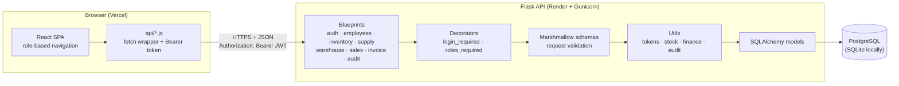
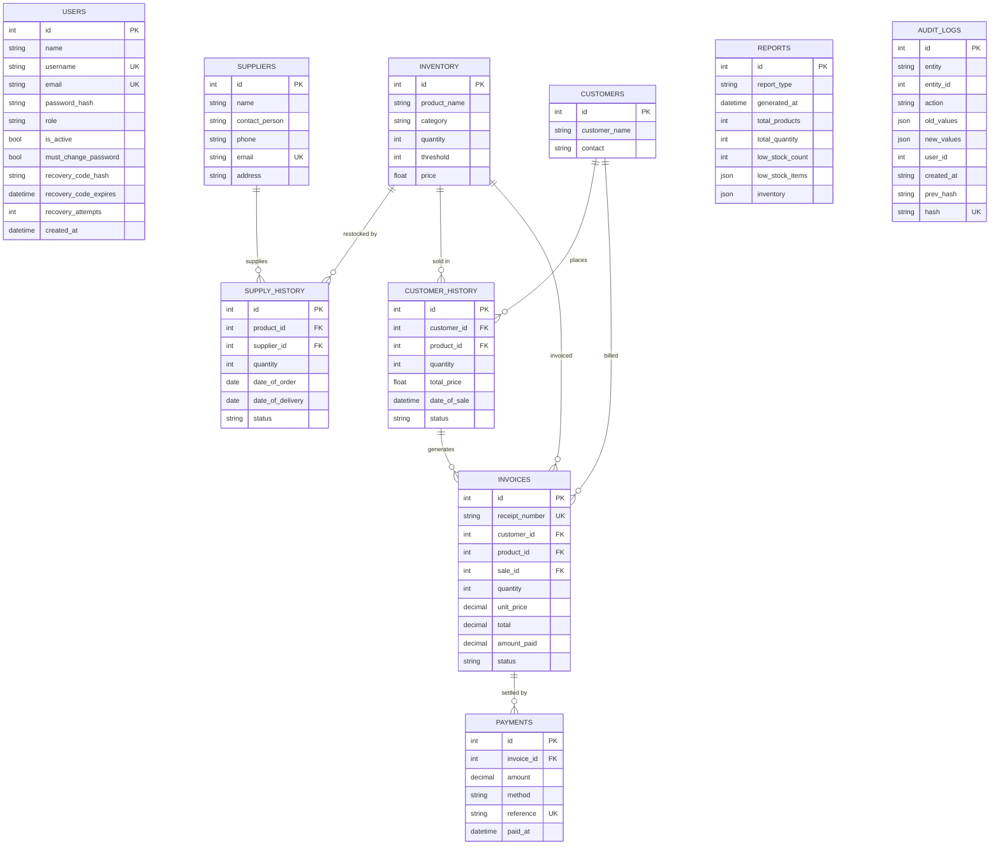

<div align="center">

# Supply Hub

**A role-based inventory, supply-chain, sales and finance management system.**

Track stock, manage suppliers and deliveries, process customer orders, issue invoices and payments, and keep a tamper-evident audit trail, all from one web app with access scoped to each employee's role.

[](client)
[](server)
[](#-tech-stack)
[](#-authentication--security)
[](https://supply-hub-inventory-management-sys.vercel.app)

[Live Demo](https://supply-hub-inventory-management-sys.vercel.app) · [API on Render](https://supply-hub-inventory-management-system-5.onrender.com) · [Report a Bug](https://github.com/darktotem/Supply-Hub-inventory-management-system/issues)

</div>

---

## Table of Contents

- [About the Project](#-about-the-project)
- [Features](#-features)
- [Tech Stack](#-tech-stack)
- [Architecture](#-architecture)
- [Roles & Permissions](#-roles--permissions)
- [Project Structure](#-project-structure)
- [Getting Started](#-getting-started)
- [Environment Variables](#-environment-variables)
- [Database & Migrations](#-database--migrations)
- [Running Tests](#-running-tests)
- [API Reference](#-api-reference)
- [Data Model](#-data-model)
- [Authentication & Security](#-authentication--security)
- [Deployment](#-deployment)
- [Known Limitations & Roadmap](#-known-limitations--roadmap)
- [Contributing](#-contributing)

---

## About the Project

Supply Hub is a B2B SaaS Internal tool mangement system that aims to help Enterprises track their their Inventories, Procurment and Sales, all in one application. intergrating financial systems such as; invoices and audits to comply with financial regulations. 

- **Procurement** buys stock from suppliers.
- **Warehouse staff** receive deliveries and report on inventory.
- **Sales** sells products to customers.
- **Finance** invoices those sales and records payments.
- **Auditors** get read-only visibility into everything, plus a cryptographically chained audit log.
- **IT** manages employee accounts.

Every employee signs in with their own account and only sees (and can only call) what their role allows, on both the frontend navigation and the backend API.

---

## Features

| Area | What you can do |
|------|-----------------|
| **Inventory** | Create, view, search, update and delete products. Set stock thresholds and list low-stock items. |
| **Suppliers & Supply Orders** | Register and remove suppliers, place supply orders, cancel orders, and view supply history. |
| **Warehouse** | Add products, mark supply orders as delivered (stock is increased automatically), and generate and review inventory reports. |
| **Sales** | Register and remove customers, place customer orders, fulfil or cancel them (stock is decreased automatically). |
| **Finance** | Create invoices, record partial or full payments, and track invoice status (`pending` → `partial` → `paid`). |
| **Audit** | Every sensitive action is written to a hash-chained audit log. Anyone can verify the chain has not been tampered with. |
| **Employee management** | IT can register, edit, deactivate/restore and delete employees, and issue time-limited password recovery codes. |
| **Account security** | Forced password change on first login, bcrypt hashing, JWT sessions that die when the password changes, rate-limited recovery codes. |
| **API docs** | Interactive Swagger UI generated from the route docstrings (Flasgger). |

---

## Tech Stack

**Frontend** (`client/`)

- [React 19](https://react.dev/) with the React Compiler (Babel plugin)
- [Vite 8](https://vitejs.dev/) dev server and bundler
- [Tailwind CSS 4](https://tailwindcss.com/) (via `@tailwindcss/vite`) plus hand-written CSS per feature
- Native `fetch` wrapper for API calls (`axios` is also installed)
- ESLint 10 (React Hooks and React Refresh rules)

**Backend** (`server/`)

- [Flask](https://flask.palletsprojects.com/) with Blueprints
- [Flask-SQLAlchemy](https://flask-sqlalchemy.palletsprojects.com/) and [Flask-Migrate](https://flask-migrate.readthedocs.io/) (Alembic)
- [Marshmallow](https://marshmallow.readthedocs.io/) for request validation
- [Flask-Bcrypt](https://flask-bcrypt.readthedocs.io/) for password hashing, [PyJWT](https://pyjwt.readthedocs.io/) for tokens
- [Flasgger](https://github.com/flasgger/flasgger) for Swagger docs
- [Gunicorn](https://gunicorn.org/) for production serving
- [pytest](https://pytest.org/) for tests, [Faker](https://faker.readthedocs.io/) for dev data
- Pipenv for dependency management

**Database**: SQLite for local development, PostgreSQL (via `psycopg`) in production.

**Hosting**: Frontend on **Vercel**, backend and database on **Render**.

---

## Architecture

> A generated diagram is also available on [GitDiagram](https://gitdiagram.com/darktotem/supply-hub-inventory-management-system).

[](https://gitdiagram.com/darktotem/supply-hub-inventory-management-system?utm_source=readme&utm_medium=picture)

### High-level overview


### Request lifecycle

1. The React app calls `api("/path", options)` in `client/src/api/client.js`, which attaches the JWT stored in `localStorage` as `Authorization: Bearer <token>`.
2. Flask handles CORS (origins come from `CORS_ORIGINS`), then routes the request to a Blueprint.
3. `@login_required` decodes the token and loads the user. `@roles_required(...)` then checks the user's role.
4. The payload is validated with a Marshmallow schema (`utils/validators.load_json`).
5. The controller changes the database through SQLAlchemy models, using `utils/stock.py` for stock changes and `utils/audit.py` / `utils/finance.py` for audit entries.
6. A JSON response (or `{"error": "..."}` with the proper status code) goes back to the client.

---

## Roles & Permissions

Seven roles are defined in `server/models/user.py`. The frontend builds its menu from the signed-in role, and the backend enforces the same rules independently.

| Role (`value`) | Frontend pages | Can write |
|---|---|---|
| **IT Admin** (`it_admin`) | Employees | Employee accounts only |
| **Operations Director** (`operations_director`) | Dashboard, Inventory, Products, Deliveries, Reports | Inventory, suppliers, supply orders, warehouse, customers and orders, reads finance data |
| **Procurement Officer** (`procurement_officer`) | Inventory, Suppliers, Supply Orders, Supply History | Inventory, suppliers, supply orders |
| **Store Worker** (`store_worker`) | Inventory, Products, Deliveries, Reports | Inventory, products, deliveries, reports |
| **Sales Officer** (`sales_officer`) | Inventory, Customers, Customer Orders | Inventory, customers, customer orders |
| **Finance Officer** (`finance_officer`) | Inventory (read-only), Invoices | Invoices and payments |
| **Auditor** (`auditor`) | Everything, **read-only**, plus Audit Logs | Nothing |

> The exact per-endpoint role lists are in the [API Reference](#-api-reference).

---

## 📁 Project Structure

```
Supply-Hub-inventory-management-system/
├── README.md
├── .gitignore
│
├── client/                          #     React + Vite frontend
│   ├── index.html                   #     HTML entry
│   ├── package.json                 #     scripts + dependencies
│   ├── vite.config.js               #     Vite + React + Tailwind plugins, port 5173
│   ├── eslint.config.js
│   ├── jsconfig.json                #     type-checking config (`npm run typecheck`)
│   ├── Architecture.md              #     original role / feature planning notes
│   ├── .env.production              #     VITE_API_URL for the deployed backend
│   ├── public/                      #     favicon and static icons
│   └── src/
│       ├── main.jsx                 #     React root
│       ├── App.jsx                  #     renders <AppRoutes />
│       ├── App.css · index.css      #     global styles
│       │
│       ├── routes/
│       │   └── AppRoutes.jsx        #     auth gate, forced password change,
│       │                            #     role-based navigation, page switching
│       ├── api/                     #     one module per backend area
│       │   ├── client.js            #     fetch wrapper (base URL, token, errors)
│       │   ├── auth.js              #     login, password and username changes, recovery
│       │   ├── inventory.js
│       │   ├── supply.js
│       │   ├── warehouse.js
│       │   ├── sales.js
│       │   ├── invoice.js · finance.js
│       │   ├── audit.js
│       │   └── errors.js
│       ├── components/              #     shared UI
│       │   ├── Navbar.jsx
│       │   ├── DataTable.jsx
│       │   ├── ErrorMessage.jsx
│       │   └── StatusBudge.jsx
│       └── features/                #     one folder per screen group
│           ├── auth/                #     login
│           ├── admin/               #     dashboard, employees
│           ├── inventory/           #     inventory
│           ├── supply/              #     history, reg_suppliers, supply_orders
│           ├── wearhouse/           #     add_product, deliveries, reports
│           ├── sales/               #     customers, customer_orders
│           ├── finance/             #     invoices, payment
│           └── auditor/             #     audit_dashboard
│
└── server/                          #     Flask REST API
    ├── app.py                       #     app factory-style entry: config, CORS, blueprints, Swagger
    ├── config.py                    #     environment-driven Config class
    ├── extensions.py                #     db, migrate, bcrypt instances
    ├── seed.py                      #     creates the first IT admin and sample inventory
    ├── Pipfile · Pipfile.lock       #     Python dependencies
    │
    ├── controllers/                 #     Blueprints (route handlers)
    │   ├── auth.py                  #     login, change password/username, recovery flow
    │   ├── employees.py             #     employee CRUD, access control, password reset
    │   ├── inventory.py             #     inventory CRUD, low-stock, search
    │   ├── supply.py                #     suppliers, supply orders, history
    │   ├── warehouse.py             #     products, deliveries, reports
    │   ├── sales.py                 #     customers, customer orders, fulfil/cancel
    │   ├── invoice.py               #     invoices and payments
    │   └── audit.py                 #     audit-chain verification
    │
    ├── models/                      #     SQLAlchemy models
    │   ├── __init__.py              #     imports every model (needed by migrations)
    │   ├── user.py                  #     User, Role, ALL_ROLES, recovery-code logic
    │   ├── inventory.py
    │   ├── supplier.py
    │   ├── supply_history.py
    │   ├── customer.py
    │   ├── customer_history.py
    │   ├── invoice.py               #     Invoice, Payment
    │   ├── report.py
    │   └── audit.py                 #     AuditLog (hash-chained)
    │
    ├── schemas/                     #     Marshmallow request validation
    │   ├── auth_schema.py
    │   ├── inventory_schema.py
    │   ├── supply_schema.py
    │   ├── warehouse_schema.py
    │   ├── sales_schema.py
    │   └── invoice_schema.py
    │
    ├── utils/
    │   ├── constants.py             #     SupplyStatus, CustomerOrderStatus, PaymentStatus
    │   ├── decorators.py            #     login_required, roles_required, current_user
    │   ├── tokens.py                #     create/decode access and reset JWTs
    │   ├── validators.py            #     load_json (Marshmallow wrapper)
    │   ├── stock.py                 #     increase_stock / decrease_stock
    │   ├── finance.py               #     money rounding, invoice status, audit hash chain
    │   ├── audit.py                 #     log_action helper
    │   └── errors.py                #     JSON error handlers
    │
    ├── migrations/                  #     Alembic migrations
    │   ├── alembic.ini · env.py · script.py.mako
    │   └── versions/
    │       ├── befd303f4973_initial_tables.py
    │       └── 7b99822060b3_widen_audit_logs_action.py
    │
    ├── instance/
    │   └── inventory.db             #     local SQLite database (dev)
    │
    └── tests/                       #     pytest suite
        ├── conftest.py              #     app, DB and per-role token fixtures
        ├── test_auth.py
        ├── test_access_controls.py
        ├── test_employees.py
        ├── test_inventory.py
        ├── test_suppliers.py
        ├── test_supply_history.py
        ├── test_customer.py
        ├── test_customer_history.py
        ├── test_invoice.py
        └── test_payments.py
```

---

## Getting Started

### Prerequisites

| Tool | Version | Notes |
|------|---------|-------|
| **Git** | any recent | |
| **Python** | 3.11+ | Developed locally on 3.14 |
| **Pipenv** | latest | `pip install --user pipenv` |
| **Node.js** | 20.19+ (22 LTS recommended) | Needed by Vite |
| **npm** | bundled with Node | |

### 1. Clone the repository

```bash
git clone https://github.com/darktotem/Supply-Hub-inventory-management-system.git
cd Supply-Hub-inventory-management-system
```

### 2. Set up the backend

```bash
cd server

# Install dependencies and open the virtual environment
pipenv install
pipenv shell
```

Create `server/.env` (see [Environment Variables](#-environment-variables)). For local development you can leave everything unset, because safe-for-dev defaults are built in, but it is best to set your own secrets:

```env
SECRET_KEY=change-me-to-a-long-random-string
JWT_SECRET_KEY=change-me-too-another-long-random-string
```

Apply the migrations and seed the database:

```bash
flask db upgrade        # creates / updates instance/inventory.db
python seed.py          # creates the first IT admin + sample products
```

Start the API:

```bash
flask run               # http://127.0.0.1:5000
```

Open the interactive API docs at **http://127.0.0.1:5000/apidocs/**.

> **Seeded admin account (development only)**
>
> | Username | Password | Role |
> |---|---|---|
> | `testadmin` | `must_change_password` | `it_admin` |
>
> You are forced to choose a new password on first login. Never use the default credentials in production.

### 3. Set up the frontend

Open a second terminal:

```bash
cd client
npm install
npm run dev             # http://localhost:5173
```

The client talks to `http://127.0.0.1:5000` by default. To point it somewhere else, create `client/.env.local`:

```env
VITE_API_URL=http://127.0.0.1:5000
```

### 4. First run walkthrough

1. Sign in as `testadmin` and set a new password when prompted.
2. In **Employees**, register one account per role (Operations Director, Procurement, Store Worker, Sales, Finance, Auditor). Each new account must change its password on first sign-in.
3. Sign in as each role to see its own menu and permissions.
4. Try the full cycle: **Procurement** creates a supplier and supply order → **Store Worker** marks it delivered (stock goes up) → **Sales** creates a customer order and fulfils it (stock goes down) → **Finance** creates an invoice and records payments → **Auditor** verifies the audit log.

### Useful scripts

| Where | Command | What it does |
|-------|---------|--------------|
| `client/` | `npm run dev` | Start the Vite dev server on port 5173 |
| `client/` | `npm run build` | Production build into `client/dist` |
| `client/` | `npm run preview` | Serve the production build locally |
| `client/` | `npm run lint` | Run ESLint |
| `client/` | `npm run typecheck` | Type-check JS with `jsconfig.json` |
| `server/` | `flask run` | Start the API on port 5000 |
| `server/` | `flask db upgrade` | Apply database migrations |
| `server/` | `python seed.py` | Seed the first admin and sample inventory |
| `server/` | `pytest` | Run the backend tests |

---

## Environment Variables

### Backend (`server/.env`)

| Variable | Default | Description |
|----------|---------|-------------|
| `DATABASE_URL` | `sqlite:///inventory.db` | Database connection string. `postgres://` and `postgresql://` URLs are rewritten to the `psycopg` driver automatically. |
| `SECRET_KEY` | dev-only placeholder | Flask secret key. **Set a long random value in production.** |
| `JWT_SECRET_KEY` | dev-only placeholder | Signing key for JWTs. **Set a long random value in production.** |
| `JWT_EXPIRES_HOURS` | `8` | Lifetime of an access token. |
| `CORS_ORIGINS` | `http://localhost:5173,https://supply-hub-inventory-management-sys.vercel.app` | Comma-separated list of frontend origins allowed to call the API. |

Generate a good secret with:

```bash
python -c "import secrets; print(secrets.token_urlsafe(48))"
```

### Frontend (`client/.env*`)

| Variable | Default | Description |
|----------|---------|-------------|
| `VITE_API_URL` | `http://127.0.0.1:5000` | Base URL of the backend API. `client/.env.production` points it at the Render deployment. |

---

## Database & Migrations

Schema changes are managed with Flask-Migrate (Alembic). Run these from `server/`:

```bash
# After editing a model
flask db migrate -m "describe the change"
flask db upgrade
```

Always **review the generated file** in `migrations/versions/` before committing it, and make sure `flask db heads` prints exactly one revision.

Current migrations:

| Revision | Description |
|----------|-------------|
| `befd303f4973` | Initial tables |
| `7b99822060b3` | Widen `audit_logs.action` from 20 to 100 characters |

**Resetting your local database**

```bash
rm instance/inventory.db
flask db upgrade
python seed.py
```

**Troubleshooting `Can't locate revision identified by '...'`**: your local database is stamped with a migration that is not in your checkout. Pull the latest code, or reset the local database as above.

---

## Running Tests

```bash
cd server
pipenv run pytest            # run everything
pipenv run pytest -v         # verbose
pipenv run pytest tests/test_auth.py          # a single file
```

Tests use a temporary SQLite database and per-role JWT fixtures from `tests/conftest.py`, so they never touch your development data. They cover authentication, role-based access control, employees, inventory, suppliers, supply and customer history, invoices and payments.

---

## API Reference

All endpoints return JSON. Protected endpoints need `Authorization: Bearer <token>`. Interactive docs are served at **`/apidocs/`**.

Errors look like `{"error": "message"}`, or `{"errors": {...}}` for validation failures. Typical status codes: `400`/`422` invalid input, `401` missing or invalid token, `403` role not allowed, `404` not found.

**Role key:** `ITA` IT Admin · `OPS` Operations Director · `PRO` Procurement · `STW` Store Worker · `SAL` Sales · `FIN` Finance · `AUD` Auditor · **Any** any signed-in user · **Public** no token needed.

### Authentication: `/api`

| Method | Endpoint | Access | Description |
|--------|----------|--------|-------------|
| `POST` | `/api/login` | Public | Log in, returns `{ token, user }`. |
| `PATCH` | `/api/change_password` | Any | Change your own password (clears the forced-change flag). |
| `PATCH` | `/api/change_username` | Any | Change your own username. |
| `POST` | `/api/verify_recovery_code` | Public | Forgot-password step 2: exchange a recovery code for a short-lived reset token. |
| `POST` | `/api/set_new_password` | Public | Forgot-password step 3: set a new password with the reset token. |

### Employees: `/api/employees`

| Method | Endpoint | Access | Description |
|--------|----------|--------|-------------|
| `GET` | `/api/employees` | ITA | List employees. |
| `POST` | `/api/employees` | ITA | Register an employee. |
| `PATCH` | `/api/employees/<id>` | ITA | Edit employee details. |
| `PATCH` | `/api/employees/<id>/access` | ITA | Deny or restore access. |
| `POST` | `/api/employees/<id>/reset_password` | ITA | Issue a 60-second recovery code and force a password change. |
| `DELETE` | `/api/employees/<id>` | ITA | Delete an employee. |

### Inventory: `/inventory`

| Method | Endpoint | Access | Description |
|--------|----------|--------|-------------|
| `GET` | `/inventory` | PRO, STW, SAL, FIN, AUD, OPS | List all products. |
| `POST` | `/inventory` | STW, OPS, PRO, SAL | Create a product. |
| `GET` | `/inventory/<id>` | PRO, STW, SAL, FIN, AUD, OPS | Get one product. |
| `PUT` | `/inventory/<id>` | STW, OPS, PRO, SAL | Update a product. |
| `DELETE` | `/inventory/<id>` | STW, OPS, PRO, SAL | Delete a product. |
| `GET` | `/inventory/low-stock` | PRO, STW, SAL, FIN, AUD, OPS | Products at or below their threshold. |
| `POST` | `/inventory/search` | PRO, STW, SAL, FIN, AUD, OPS | Search products. |

### Suppliers & supply orders

| Method | Endpoint | Access | Description |
|--------|----------|--------|-------------|
| `GET` | `/suppliers` | Any | List suppliers. |
| `POST` | `/register_supplier` | PRO, OPS | Register a supplier. |
| `DELETE` | `/delete_suppliers/<id>` | PRO, OPS | Delete a supplier. |
| `GET` | `/supplyhistory` | Any | List supply orders and their status. |
| `POST` | `/supply_orders` | PRO, OPS | Create a supply order. |
| `PATCH` | `/cancel_order/<id>` | PRO, OPS | Cancel a pending supply order. |
| `PATCH` | `/deliver_order/<id>` | PRO, OPS | Mark an order delivered and increase stock. |

### Warehouse

Each warehouse route is also registered under three alias prefixes (`/api/warehouse/...`, `/products`, `/api/products`, and so on) for backwards compatibility. The frontend uses the `/warehouse/...` form.

| Method | Endpoint | Access | Description |
|--------|----------|--------|-------------|
| `GET` | `/warehouse/products` | Any | List warehouse products. |
| `POST` | `/warehouse/products` | STW, OPS | Add a product. |
| `PATCH` | `/warehouse/products/<id>` | STW, OPS | Update a product. |
| `GET` | `/warehouse/deliveries` | Any | Pending and completed deliveries. |
| `PATCH` / `POST` | `/warehouse/deliveries/<id>/deliver` | STW, OPS | Mark a delivery received. |
| `GET` | `/warehouse/reports` | Any | Live inventory report. |
| `POST` | `/warehouse/reports` | STW, OPS | Save an inventory report snapshot. |
| `GET` | `/warehouse/reports/history` | Any | Previously saved reports. |

### Sales

| Method | Endpoint | Access | Description |
|--------|----------|--------|-------------|
| `GET` | `/api/customers` | Any | List customers. |
| `POST` | `/api/register_customer` | SAL, OPS | Register a customer. |
| `DELETE` | `/api/delete_customer/<id>` | SAL, OPS | Delete a customer. |
| `GET` | `/api/customer_orders` | Any | List customer orders. |
| `GET` | `/api/customer_history` | Any | Sales history. |
| `POST` | `/api/post_customer_orders` | SAL, OPS | Create a customer order. |
| `PATCH` | `/api/cancel_customer_order/<id>` | SAL, OPS | Cancel an order. |
| `PATCH` | `/api/fulfil_customer_order/<id>` | SAL, OPS | Fulfil an order and decrease stock. |

### Invoices & payments: `/invoices`

| Method | Endpoint | Access | Description |
|--------|----------|--------|-------------|
| `GET` | `/invoices/` | FIN, AUD, OPS | List invoices. |
| `POST` | `/invoices/` | FIN | Create an invoice. |
| `GET` | `/invoices/<id>/payments` | FIN, AUD, OPS | List payments on an invoice. |
| `POST` | `/invoices/<id>/payments` | FIN | Record a payment. The invoice status is recalculated automatically. |

### Audit: `/audits`

| Method | Endpoint | Access | Description |
|--------|----------|--------|-------------|
| `GET` | `/audits/verify` | Public | Walks the hash chain and returns `{ "valid": bool, "broken_at": id \| null }`. |

---

## Data Model



**Status values** (`server/utils/constants.py`)

| Entity | Values |
|--------|--------|
| Supply order | `Pending`, `Delivered`, `Cancelled` |
| Customer order | `pending`, `completed`, `cancelled` |
| Invoice | `pending`, `partial`, `paid`, `void` |
| Payment | `pending`, `paid`, `failed`, `refunded` |

---

## Authentication & Security

- **Passwords** are hashed with bcrypt and never stored in plain text.
- **JWT access tokens** (HS256, default 8-hour lifetime) carry the user id and a fingerprint of the current password hash. Changing or resetting a password therefore **invalidates all existing sessions** for that user.
- **Deactivated users** are rejected immediately, even with an otherwise valid token.
- **Forced password change**: new employees and accounts reset by IT must set a new password before the app lets them in.
- **Password recovery**: IT issues a one-time code (format `A1B2-C3D4-E5F6`, valid for 60 seconds). Only its bcrypt hash is stored, and after 5 wrong attempts the code is locked. A correct code is exchanged for a 60-second reset token that works only for password reset.
- **Role-based access control** is enforced server-side by `@roles_required`; the frontend menu is a convenience, not a security boundary.
- **CORS** only allows the origins listed in `CORS_ORIGINS`.
- **Tamper-evident audit log**: each `audit_logs` row stores `prev_hash` and `hash = SHA-256(prev_hash + entry)`. Editing or deleting any past row breaks the chain, and `GET /audits/verify` reports the first broken entry.
- **Money** is handled with `Decimal` and rounded half-up to 2 places.

---

## Deployment

| Part | Platform | Notes |
|------|----------|-------|
| Frontend | **Vercel** | Typical settings: root directory `client`, build `npm run build`, output `dist`. `VITE_API_URL` is read from `client/.env.production`. |
| Backend | **Render** web service | Typical settings: root directory `server`, start command `gunicorn app:app` (gunicorn is in the Pipfile). |
| Database | **Render PostgreSQL** | Set `DATABASE_URL` on the web service. |

Checklist for a new backend deployment:

1. Set `DATABASE_URL`, `SECRET_KEY`, `JWT_SECRET_KEY` and `CORS_ORIGINS` (include your Vercel URL).
2. Run migrations once from the Render shell (or add this before the start command):
   ```bash
   flask db upgrade
   ```
3. Run `python seed.py` once to create the first admin, then change its password immediately.
4. Point `VITE_API_URL` in the frontend at the backend URL and redeploy.


## Contributing

1. Fork the repository and create a branch: `git checkout -b feature/your-feature`
2. Make your changes. For model changes, include a reviewed Alembic migration.
3. Run `pytest` in `server/` and `npm run lint` in `client/`.
4. Commit with a clear message and open a pull request against `main`.
